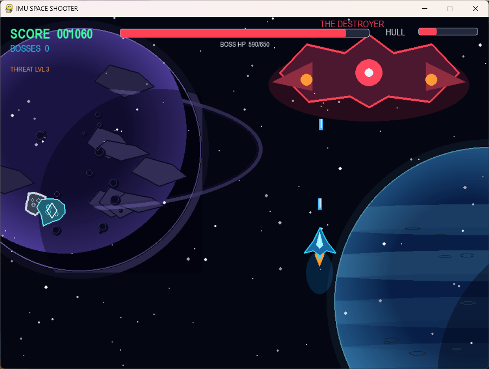
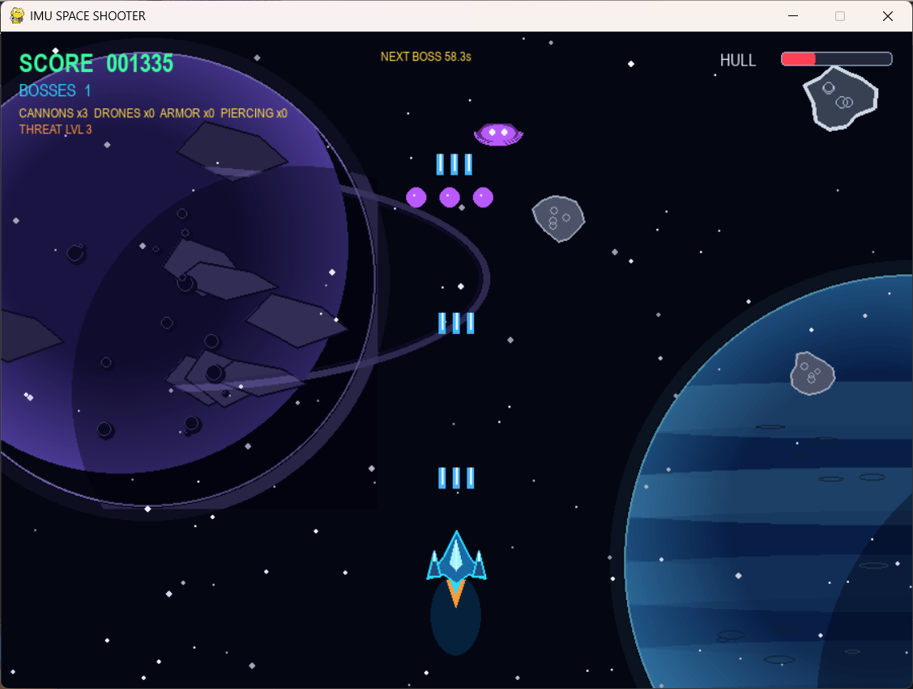
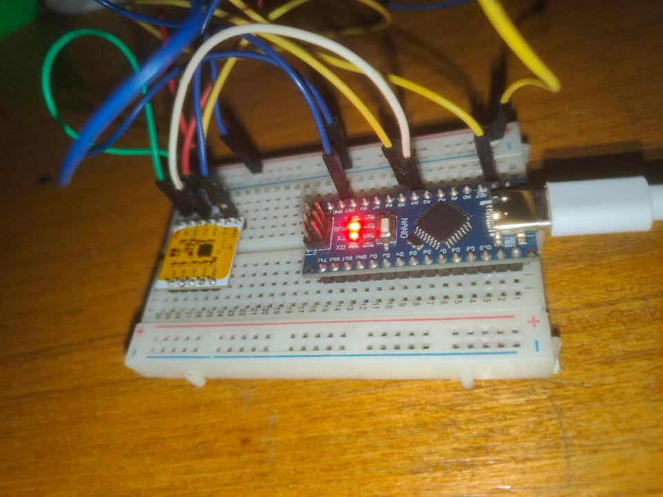

# IMU Space Shooter

A personal project combining Arduino, an IMU sensor, and Python to create a motion-controlled space shooter.

Instead of using a keyboard, I use a physical controller with a gyroscope to move the spaceship by tilting it.

## Gameplay






## Features

- Motion-controlled spaceship movement
- Automatic shooting
- Multiple asteroid types
- Enemy aliens with different attack patterns
- Boss battles with unique abilities
- Power-ups and permanent upgrades
- Increasing difficulty over time
- Procedurally generated game graphics

## Hardware

The project uses an Arduino-based IMU controller to capture the player's physical movements.



**Components:**
- Arduino Nano
- LSM6DSV IMU sensor
- Breadboard and jumper wires
- USB serial connection

## Technologies

- Python
- Pygame
- PySerial
- Arduino IDE
- C++ (Arduino)

## How to Run

1. Clone this repository.
2. Install the Python dependencies:

   ```bash
   pip install -r requirements.txt
   ```

3. Upload the Arduino sketch from the `arduino` folder.
4. Connect the Arduino to your computer.
5. Check and update the serial port in the Python script if necessary.
6. Start the game:

   ```bash
   python imu_space_shooter.py
   ```


## Hardware Wiring

### Arduino Nano to LSM6DSV

| LSM6DSV Pin | Arduino Nano |
|---|---|
| VCC | 3.3V |
| GND | GND |
| SDA | A4 |
| SCL | A5 |
| SDO | GND |
| CS | 3.3V |

### Communication Settings

- Interface: I2C
- I2C Address: `0x6A`
- Serial Baud Rate: `115200`


## Project Status

This is a temporary personal project. I might improve the physical controller, add more game mechanics, and eventually make the controller wireless in the future.

## Author

**Johndy Q. Salomon**